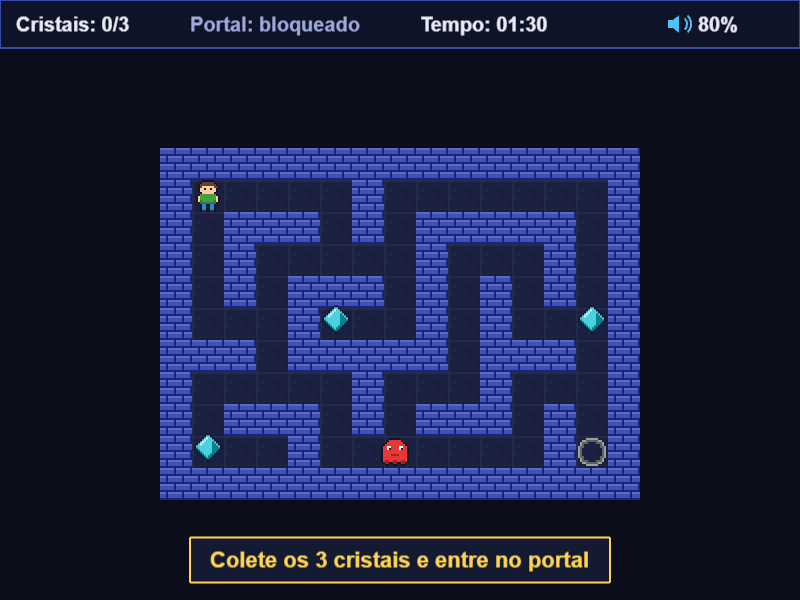

# Labirinto do Tempo

Jogo 2D de labirinto para navegador, desenvolvido para a disciplina **PEX1253 - Multimídia**
(UFERSA, campus Pau dos Ferros).
Autor: **Mateus Gomes Pinheiro**.



## O jogo

Rafael está preso em um labirinto e o tempo está correndo. Em cada fase o jogador precisa:

1. explorar o labirinto e **coletar os 3 cristais**;
2. com os 3 cristais, o **portal é liberado** (muda de cinza para roxo e começa a brilhar);
3. **entrar no portal antes do cronômetro zerar**.

Inimigos patrulham os corredores: encostar em um deles **tira 5 segundos** do cronômetro.
Se o tempo acabar, é derrota.

São **3 fases** com dificuldade crescente:

| Fase | Nome | Tamanho | Tempo | Inimigos | Velocidade dos inimigos |
|---|---|---|---|---|---|
| 1 | Primeiros Passos | 15 × 11 | 90 s | 1 | 60 px/s |
| 2 | Corredores Sombrios | 21 × 15 | 75 s | 3 | 80 px/s |
| 3 | O Coração do Labirinto | 25 × 17 | 70 s | 5 | 100 px/s |

A fase seguinte só é liberada depois de concluir a anterior.

### Pontuação

```
pontos = 1000 + (tempo restante × 10) − (danos × 100)      (mínimo 0)
```

Estrelas: **3** se terminar com mais de 50% do tempo, **2** se com mais de 25%, senão **1**.
O melhor tempo, a melhor pontuação e as estrelas de cada fase ficam salvos no navegador.

## Controles

| Tecla | Ação |
|---|---|
| Setas ou W A S D | Mover o jogador / navegar nos menus |
| Enter ou Espaço | Confirmar |
| ESC ou P | Pausar (na partida) · Voltar (nas telas do menu) |
| + / − | Aumentar / diminuir o volume geral em 10% (na partida) |
| M | Ligar / desligar o som (na partida) |

Todos os menus também funcionam com o mouse.

## Como rodar no localhost

Requisito: [Node.js](https://nodejs.org) LTS (confira com `node -v`).

```bash
npm install      # instala as dependências (só na primeira vez)
npm run dev      # abre o jogo em http://localhost:5173
```

Outros comandos:

```bash
npm run build    # verifica os tipos (TypeScript) e gera a versão final em dist/
npm run preview  # roda a versão final em http://localhost:4173
npm run sprites  # gera de novo as imagens em public/assets/images
npm run format   # formata o código com o Prettier
npm run test:volume  # teste automático do volume no navegador (Playwright); screenshots em docs/
                     # (na primeira vez: npx playwright install chromium)
```

## Tecnologias

| Item | Escolha | Por quê |
|---|---|---|
| Linguagem | **TypeScript** (modo `strict`) | A tipagem evita erros e documenta o formato dos dados |
| Engine | **Phaser 4** | Cenas, física arcade, animações, partículas, áudio e entrada prontos |
| Servidor de desenvolvimento | **Node.js + Vite** | `npm run dev` com recarga automática; `npm run build` gera arquivos estáticos |
| Persistência | **localStorage** | Progresso e configurações salvos no navegador, sem backend |
| Imagens | Pixel art gerada por script (`scripts/gerar-sprites.mjs`) | Arte original, sem problemas de direitos autorais |
| Sons | Sintetizados com a **Web Audio API** (`SoundSynth.ts`) | Sem arquivos de áudio; tudo criado pelo código |

Não há backend: o Node.js é usado só como ambiente de desenvolvimento.

## Arquitetura

O jogo é dividido em **cenas do Phaser**, seguindo a arquitetura da informação do projeto:

```
Boas-vindas → Menu Principal → { Jogar, Como Jogar, Progresso, Configurações, Ajuda }
Jogar → Mapa de Fases (com dificuldade) → Partida (HUD + Pausa) → Resultado → próxima fase / menu
```

- O menu tem só 5 opções, e toda tela secundária tem um botão "Voltar ao menu" (ou ESC).
- A **partida** (`GameScene`) e o **HUD** (`HudScene`) rodam **ao mesmo tempo**, em paralelo.
- A **pausa** (`PauseScene`) abre por cima da partida e congela tudo: física, cronômetro e animações.

### Estrutura de pastas

```
labirinto-do-tempo/
├── index.html                 # página que carrega o jogo
├── package.json / tsconfig.json / vite.config.ts
├── scripts/
│   └── gerar-sprites.mjs      # gera a pixel art (PNG) a partir de desenhos em texto
├── public/assets/
│   ├── images/                # sprites gerados (jogador, inimigo, cristal, portal, parede, chão)
│   └── audio/                 # vazio: os sons são gerados pelo código
└── src/
    ├── main.ts                # cria o Phaser.Game com a lista de cenas
    ├── config/constants.ts    # TODAS as constantes: cores, tamanhos, teclas, chaves do localStorage
    ├── types/index.ts         # tipos: LevelData, Settings, LevelResult, SaveData...
    ├── scenes/                # uma cena por tela (Boot, Preload, Welcome, Menu, MenuArt, LevelMap,
    │                          #   Game, Hud, Pause, Result, HowToPlay, Progress, Settings, Help)
    ├── entities/              # Player, Crystal, Portal, Obstacle
    ├── systems/               # AudioManager, SoundSynth, SaveManager, LevelLoader, ScoreCalculator, Difficulty
    ├── levels/                # level1.ts, level2.ts, level3.ts (mapas em texto) e index.ts
    └── ui/                    # Button, Slider, Panel, ScreenFrame, ConfirmDialog, Theme, Transition, Effects,
                               #   TechBackground, LevelNode, DifficultySelector
```

### Fases em texto

Cada fase é um mapa em texto, fácil de editar (`src/levels/level1.ts`):

```
###############
#P....#.......#        #  parede      .  chão
#.###.#.#####.#        P  jogador     C  cristal
#.#.....#...#.#        X  portal      E  inimigo
...
```

O `LevelLoader` lê o mapa caractere por caractere: `#` vira uma parede com colisão e os outros
símbolos viram chão com o objeto correspondente. O caminho de patrulha de cada inimigo é
descoberto automaticamente: ele vai e volta pelo corredor reto mais comprido a partir do `E`.

### Comunicação entre as cenas (eventos)

A `GameScene` tem as regras do jogo e **avisa** o que acontece emitindo eventos em `this.game.events`.
A `HudScene` só **escuta** esses eventos e atualiza a tela, sem nenhuma regra de jogo:

| Evento | Quando | O que o HUD faz |
|---|---|---|
| `crystal-collected` | Coletou um cristal | Atualiza "Cristais: x/3" |
| `portal-unlocked` | Juntou os 3 cristais | "Portal: liberado" + mensagem no centro |
| `time-changed` | A cada segundo ou ao levar dano | Atualiza o cronômetro (vermelho nos últimos 10 s) |
| `player-hit` | Um inimigo tocou o jogador | Mostra "−5s" |
| `volume-changed` | Volume ou mudo mudaram | Atualiza e destaca o ícone de som |

A `ResultScene` recebe os dados da partida diretamente: `this.scene.start('ResultScene', resultado)`.

### Áudio e controle de volume

O `AudioManager` (`src/systems/AudioManager.ts`) centraliza todo o som do jogo:

- **Volume geral**, **volume da música** e **volume dos efeitos**, de 0 a 1, e **mudo**.
- O volume que se ouve é uma multiplicação: `música = geral × música` e `efeito = geral × efeitos`.
  Ex.: geral 80% e música 50% → a música toca a 40%.
- Música de fundo no menu e na partida; efeitos de cristal, portal liberado, dano, vitória, derrota e clique.
- Controles: três **sliders** e um botão de mudo em Configurações; na partida, **+ / −** e **M**.
- O HUD mostra um **ícone de alto-falante com a porcentagem**, que cresce e fica amarelo quando o volume muda.
- Tudo é salvo no **localStorage** e carregado quando o jogo abre.

Os sons são gerados pelo `SoundSynth` com a Web Audio API: cada som é uma lista de notas
(frequência e duração) tocadas com uma forma de onda (senoidal, quadrada ou triangular).
Para usar arquivos de áudio reais, coloque-os em `public/assets/audio/` e descomente as linhas
`this.load.audio(...)` na `PreloadScene`.

### Acessibilidade

Em **Configurações**:

- **Alto contraste**: fundo preto, textos brancos, destaques em amarelo e labirinto com paredes claras.
- **Texto maior**: todas as fontes ficam 20% maiores.

As duas opções ficam salvas. Na primeira vez na fase 1, aparece uma dica rápida do objetivo.

### Dados salvos (localStorage)

| Chave | Conteúdo |
|---|---|
| `labirinto-do-tempo:settings` | Volumes, mudo, alto contraste e texto maior |
| `labirinto-do-tempo:progress` | Fases concluídas, melhor tempo, melhor pontuação e estrelas de cada fase |

O progresso pode ser apagado em Configurações → "Apagar progresso" (com confirmação).

## Créditos

Todas as imagens e sons são originais e livres (CC0). Veja [CREDITOS.md](CREDITOS.md).
